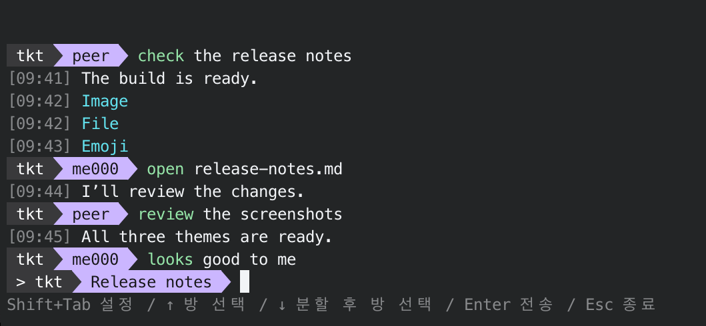
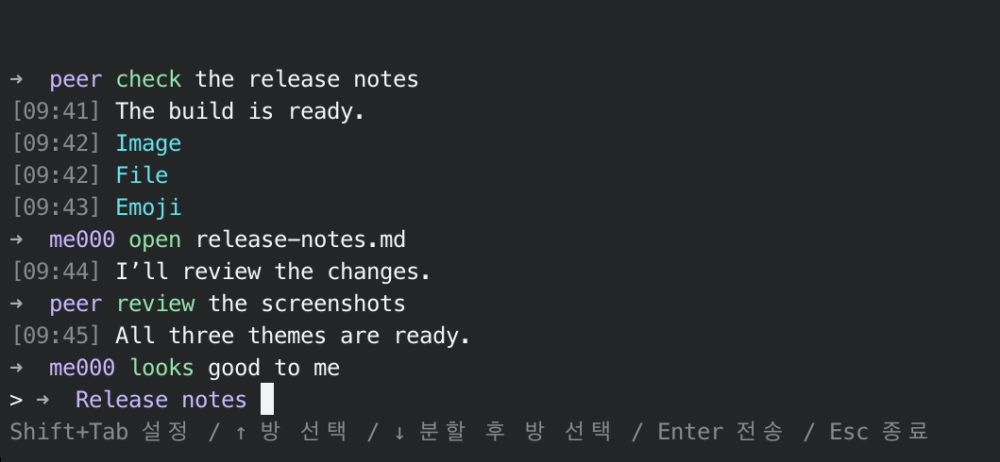
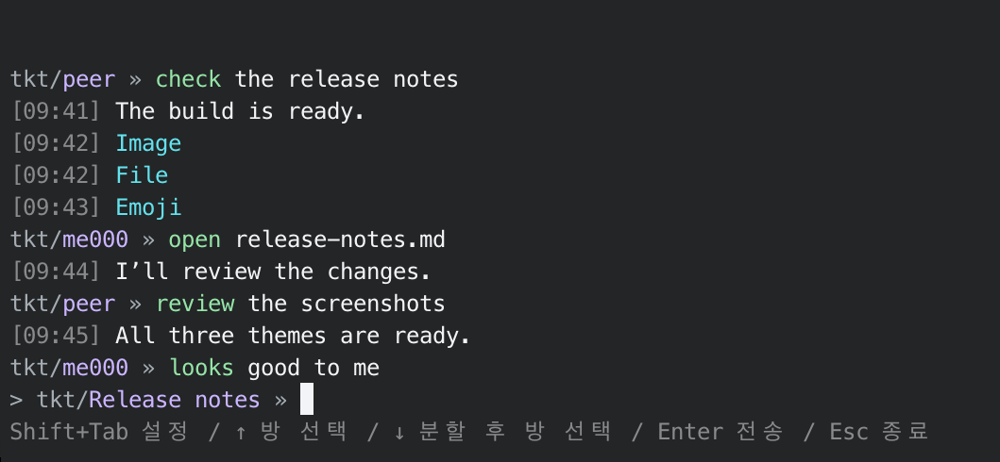
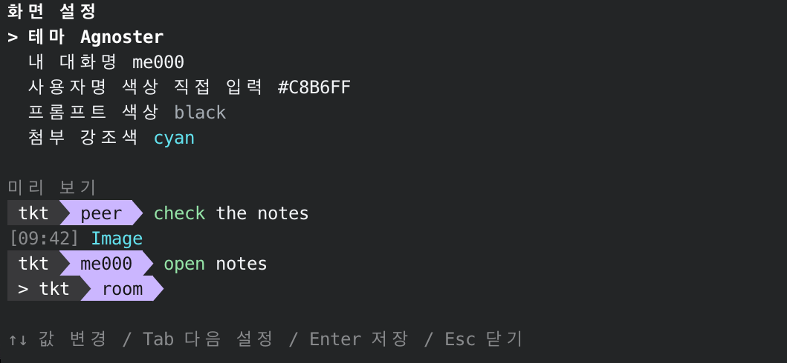

# tkt (terminal kakao talk)

터미널에서 카톡을 주고받을 수 있는 TUI (Text User Interface)


> ❗중요❗
> - 개인 환경에서만 테스트를 진행했어요. 다른 환경에서는 의도와 다르게 동작할 수 있어요
> - 카카오톡 UI의 변경에 따라 동작하지 않을 수 있어요
> - 카카오가 공식으로 허용한 방식이 아니니 사용 방식에 따라 카카오 이용약관 또는 운영정책 위반으로 해석될 수 있어요
> - 맥북에서만 가능해요

## 시작하기 전에
### 필요사항

| 항목 | 이유 |
|---|---|
| macOS 13 이상 | 카카오톡 Mac 앱과 접근성 API를 위해 필요해요 |
| Xcode Command Line Tools | `swiftc` 로 네이티브 헬퍼를 빌드해요 (`xcode-select --install`) |
| Mac용 카카오톡 앱 | 로그인 + 채팅창 열림 상태 |
| Node 20 이상 | npm을 사용해요 |

### 동작 원리
- macOS Accessibility API로 카카오톡 UI를 직접 읽고 조작해요
- 실행하고자 하는 터미널에 손쉬운 사용 권한이 필요해요
- **읽기**
  - 채팅창에서에서 시각, 보낸 사람, 본문을 읽어요
  - 말풍선이 오른쪽 끝에 붙어 있으면 내가 보낸 것으로 간주해요
- **전송**
  - 입력창의 내용을 보내고자 하는 메시지로 치환하고 전송 버튼을 눌러요
  - 키 이벤트를 쓰지 않으므로 카카오톡 창을 앞으로 끌어올리지 않아요
- 카카오톡 UI가 한국어 또는 영어인 경우만 동작해요
  - 다른 언어를 사용하는 경우 `native/tkt-ax.swift` 의 `chatListWindowTitles`, `sendButtonTitles` 수정이 필요해요

## 실행
- 실행하기 전에 카카오톡에서 보고 싶은 방을 각각 별도 창으로 열어두세요.
- 사용할 터미널 앱에 macOS 손쉬운 사용 권한을 켜주세요.
```bash
npm install
npm run dev
```

### 기본 터미널 선택

- `npm run launch -- --setup`으로 현재 터미널, macOS Terminal, iTerm2 중 하나를 고르고 `npm run launch`로 실행해요.

### 화면 설정

- 첫 실행 때 테마, 대화명, 색상을 고를 수 있어요. 실행 중에는 `Shift+Tab`으로 설정을 열어요.
- `Tab`으로 항목을 이동하고 `↑`/`↓`로 값을 바꿔요. `Enter`로 저장하고 `Esc`로 닫아요.
- 프롬프트와 사용자명 색상은 ANSI 프리셋이나 `#RRGGBB`로 지정해요. Agnoster의 화살표에는 Powerline 또는 Nerd Font가 필요해요.
- 사진, 이모티콘, 통화는 `Image`, `Emoji`, `Voice Call` 등으로 표시해요. 화면 설정에서 첨부 강조색을 고를 수 있어요.

#### 테마별 화면

세 테마는 [Oh My Zsh](https://github.com/ohmyzsh/ohmyzsh/wiki/Themes)를 참고했어요.

<details>
<summary>Agnoster</summary>



</details>

<details>
<summary>Robbyrussell</summary>



</details>

<details>
<summary>Minimal</summary>



</details>

<details>
<summary>화면 설정</summary>



</details>

## 사용법

기본 화면은 채팅방 한 칸이에요. `↓`를 누르면 새 칸과 방 선택 목록이 열려요. 방을 고른 뒤 `Enter`를 누르면 연결돼요.

| 키 | 동작 |
|---|---|
| `Enter` | 활성 칸의 방에 메시지 전송 |
| `Tab` | 활성 칸 이동 |
| `Shift+Tab` | 화면 설정 |
| `↑` | 활성 칸에서 열려 있는 채팅방 선택 |
| `↓` | 한 칸에서는 분할 후 방 선택 / 두 칸에서는 좌우와 상하 전환 |
| `Esc` | 종료 |

## 라이선스

[MIT](LICENSE)
